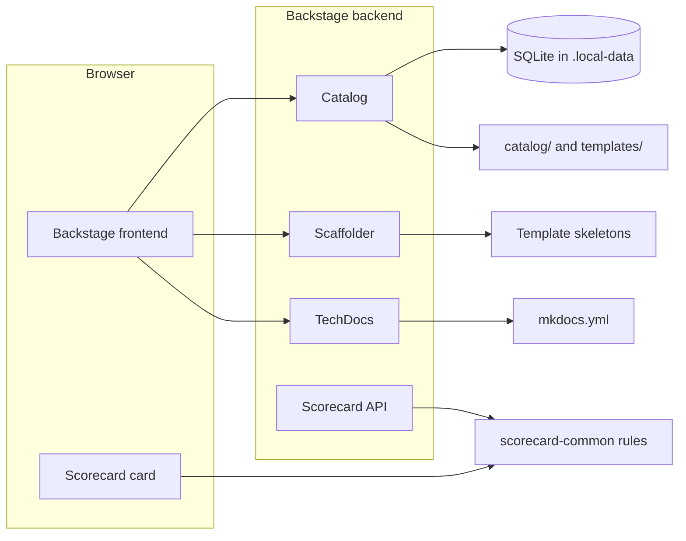
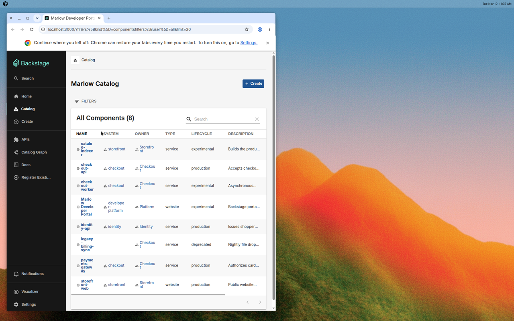
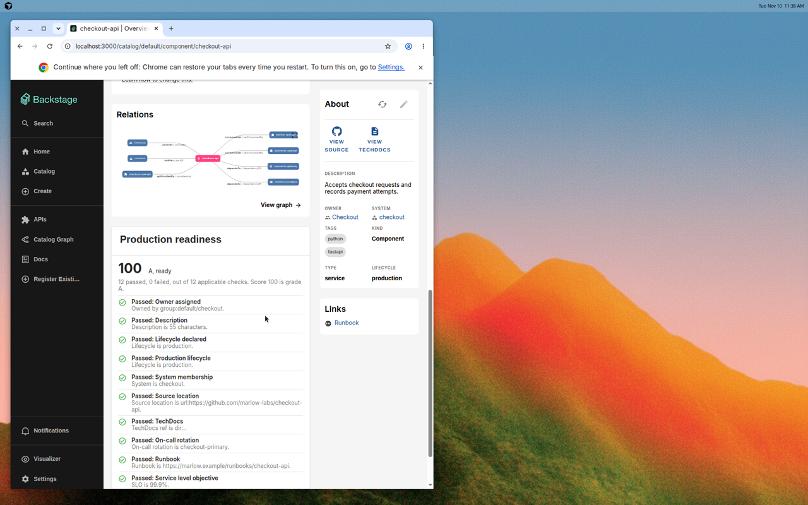
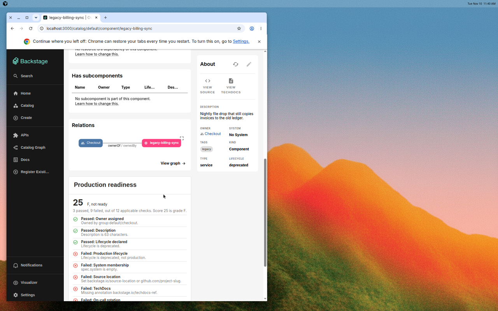
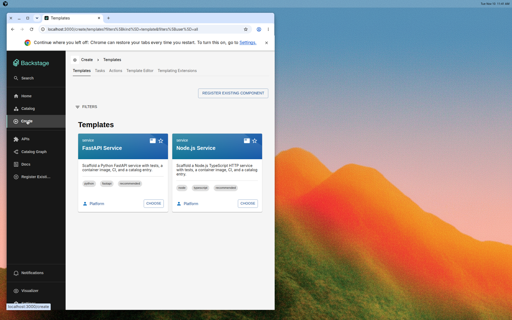

# Marlow Developer Portal

Self-service developer portal for **Marlow**, a fictional commerce engineering
organization. The app is [Backstage](https://backstage.io) 1.56, created with
`@backstage/create-app` 0.9.3. It runs locally on SQLite with guest sign-in.
GitHub is optional and is configured only through environment variables.

This repository is a portfolio project by Martin Couso. The catalog is example
data. It does not describe a production rollout, and this README does not
claim adoption or traffic numbers.

## What you can do

- Browse domains, systems, components, APIs, resources, groups, and users.
- Open a component and read its production-readiness scorecard.
- Dry-run a FastAPI or Node.js software template, or publish it when
  `GITHUB_TOKEN` is set.
- Read TechDocs for the portal and for the two documented sample services.

## Architecture



The frontend card and `plugins/scorecard-backend` both call
`evaluateScorecard` in `plugins/scorecard-common`. Checks look at catalog spec
fields and annotations. They do not call GitHub or a metrics vendor.

## Screenshots

Taken from a local `yarn start` on 10 November 2026, signed in as Guest. The
browser chrome is part of the capture.









## Local quickstart

Requirements: Node.js 22 or 24, and Python 3 only if you want to generate
TechDocs. Yarn 4 is vendored in `.yarn/releases` and selected by
`packageManager`.

```sh
corepack enable
yarn install
yarn start
```

Open <http://localhost:3000> and sign in as **Guest**. The backend listens on
<http://localhost:7007>.

The first start creates SQLite files under `.local-data/` (gitignored). Set
`SQLITE_DIR` to move that directory. The path is resolved from
`packages/backend`.

GitHub is already declared in `app-config.yaml`:

```yaml
integrations:
  github:
    - host: github.com
      token: ${GITHUB_TOKEN:-}
```

Copy the sample env file when you want to publish a template:

```sh
cp .env.example .env
```

Export the variables before `yarn start`, or rely on the Backstage CLI loading
a root `.env` if your CLI version does that. An empty token is enough to boot
the app, browse the catalog, and dry-run templates. `publish:github` fails
until the token can create the repository you picked.

TechDocs uses the local MkDocs generator rather than Docker:

```sh
pip install mkdocs-techdocs-core
```

Portal docs are `mkdocs.yml` and `docs/`. After generation they are linked from
the `developer-portal` component.

`app-config.production.yaml` points at Postgres through `POSTGRES_*` variables.
Local development does not use it.

On SQLite, the bundled Postgres search module logs that it is skipping
registration, so catalog search is not indexed in this setup. Kubernetes also
logs that no cluster config is present. Neither warning blocks the catalog,
templates, TechDocs, or the scorecard.

## Catalog

Seed data is in `catalog/` plus the root `catalog-info.yaml` for this portal.

| Kind | Examples |
| --- | --- |
| Domain | `commerce`, `platform` |
| System | `checkout`, `identity`, `storefront`, `developer-platform` |
| Component | `checkout-api`, `identity-api`, `payments-gateway`, `storefront-web`, `legacy-billing-sync` |
| API | `checkout-openapi`, `identity-openapi`, `payments-openapi`, `catalog-events` |
| Resource | `checkout-postgres`, `identity-postgres` |
| Group / User | platform, checkout, identity, storefront, and the `development/guest` user |

`marlow-labs/*` repository annotations are fictional labels so the scorecard
has something to read. `developer-portal` points at this GitHub repository.

## Templates

| Template | Skeleton |
| --- | --- |
| FastAPI Service | `templates/fastapi-service/skeleton` |
| Node.js Service | `templates/node-service/skeleton` |

Each skeleton includes:

- `Dockerfile`
- tests (`tests/test_health.py` or `src/server.test.ts`)
- `.github/workflows/ci.yml`
- `catalog-info.yaml` with TechDocs, source, on-call, runbook, SLO, and test annotations
- `mkdocs.yml` and a short docs page

The form collects name, description, owner, system, on-call, runbook, and a
GitHub repo location (`RepoUrlPicker`, host `github.com`). **Publish to GitHub
defaults to off.** With it off, the template fetches the skeleton and stops.
Turn it on to run `publish:github` and `catalog:register`. Use the scaffolder
dry-run to inspect rendered files without a token.

Generated services start at lifecycle `experimental`, so the scorecard's
production-lifecycle check fails until someone promotes them.

## Scorecard

The card is on the component overview page. Applicable checks are scored as a
percentage and a letter grade: A at 90, B at 75, C at 60, D at 40, otherwise F.

Service checks cover owner, description, lifecycle, production lifecycle,
system, source location, TechDocs, on-call (`marlow.dev/oncall`), runbook URL
(`marlow.dev/runbook`), SLO of at least 99% (`marlow.dev/slo`), automated tests
(`marlow.dev/has-tests: "true"`), and an API relationship. Websites skip the
SLO and API checks. The full table is in `docs/scorecard.md`.

In the seed catalog, `checkout-api` and `identity-api` pass every applicable
check. `payments-gateway` is missing TechDocs, a runbook, and an SLO.
`legacy-billing-sync` is a deprecated service with little metadata, so its
grade is low. Those differences are properties of the YAML, not measured
reliability.

The backend exposes the same function:

- `GET /api/scorecard/health`
- `POST /api/scorecard/evaluate` with `{ "entity": { ... } }`
- `GET /api/scorecard/entities/default/component/checkout-api`

Local routes are unauthenticated, matching the allow-all permission policy in
this sample. Restrict them before putting the backend on a shared network.

## Development checks

```sh
yarn lint:all
yarn tsc
yarn test
yarn build
yarn validate
```

`yarn validate` parses catalog and template YAML, checks required fields and
cross-references, and confirms each skeleton has a Dockerfile, tests, CI, and
`catalog-info.yaml`. GitHub Actions runs the same steps (see
`.github/workflows/ci.yml`).

## Roadmap

- Sign-in with GitHub OAuth, still optional so guest mode keeps working offline.
- A permission policy that replaces allow-all and the unauthenticated scorecard routes.
- Scorecard inputs from CI results, instead of only catalog annotations.
- TechDocs published to object storage, with MkDocs kept as the authoring format.
- Another template, likely a worker or a frontend, once these two stay green in CI.

## License

[MIT](LICENSE). Copyright (c) 2026 Martin Couso.
